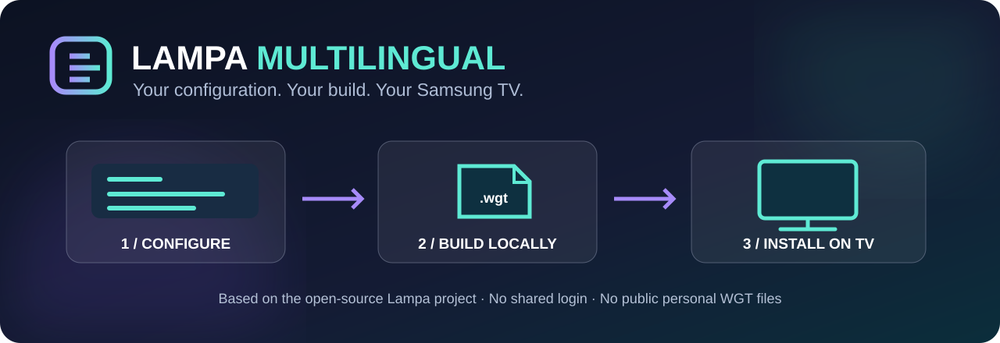

  

<h1 align="center">Lampa Multilingual</h1>

<strong>One Lampa. 21 languages. Your Samsung TV.</strong> 
An independent, community-led multilingual fork of the original open-source Lampa, with a private visual WGT Builder.

  
  
  
  

  <a href="docs/index.html"><strong>Product website</strong></a> ·
  <a href="#quick-start">Quick start</a> ·
  <a href="#visual-builder">Visual Builder</a> ·
  <a href="#what-we-changed">What's different</a> ·
  <a href="docs/INSTALLATION.md">Samsung installation</a> ·
  <a href="CONTRIBUTING.md">Contribute</a>

---

> **Current status: community preview.** Compiled-source tests, 21-language structural checks, browser-based UI scenarios and WGT packaging have been exercised. Installation, signing and video playback on a physical Samsung TV are **not yet certified**. This is not an official Lampa or Samsung distribution.

## Why Lampa Multilingual?

The original [Lampa](https://github.com/yumata/lampa-source) provides the foundation: the TV experience, catalog interface, media player, navigation and extension architecture. **Lampa Multilingual** adds extensive language support, a self-contained Tizen packaging path and a simpler local builder. Our goal is to make that experience more accessible without requiring anyone to host the Lampa application.

| 21 UI languages | Three RTL languages | Build locally |
| :--- | :--- | :--- |
| Choose a first-launch language; switch later in the TV app | Arabic, Urdu and Hebrew with RTL layout and technical-value isolation | A real WGT from your computer; no cloud compilation or account |

| Optional TorrServer | Parser and extension controls | Self-contained app resources |
| :--- | :--- | :--- |
| Enter your own server URL or leave it blank | Jackett, Prowlarr or TorrServer; third-party plugins opt-in | Bundled app JS, dictionaries, fonts and offline catalog descriptions |

## Quick start

**Requirements:** macOS or Linux, Node.js **22+**, npm, zip/unzip. Internet is needed for installing dependencies; the packaged app may contact its configured external metadata or media providers.

~~~bash
git clone https://github.com/vbrekher/lampa-personal-edition.git
cd lampa-personal-edition
npm ci
npm run builder
~~~

The command starts a **private local graphical Builder** and opens a browser at a loopback address (127.0.0.1). It does not create a hosted account or send your configuration to a public service.

Prefer terminal-only workflows? Both commands are available:

~~~bash
npm run build:multilingual -- --language nl --plugins off
# Backward-compatible legacy CLI alias:
npm run build:personal -- --language nl --plugins off
~~~

After a successful build, find **dist/Lampa-Multilingual.wgt**. A legacy-named copy is also generated for compatibility with older scripts. Use [Apps2Samsung](https://github.com/Apps2Samsung/Apps2Samsung) → **Custom WGT** to install/sign the package where supported.

## Visual Builder

The new local GUI takes you through the real configuration and packaging workflow:

1. **Welcome:** understand what the package does and does not include.
2. **TV language:** pick from 21 native-language labels; the entire dictionary catalog remains available later.
3. **TorrServer:** optionally provide your own full HTTP(S) URL. No address is required to create a WGT.
4. **Parser:** Jackett, Prowlarr or TorrServer.
5. **Third-party plugins:** off by default. Consent remains required when installing extension code in Lampa.
6. **Review:** see the exact selected inputs.
7. **Build and download:** execute the existing local compiler, view its status, receive WGT size and SHA-256, download the generated file.

The GUI and CLI share the **same validation and build implementation**. GUI messages are available in English, Russian and Dutch; this is separate from the **21 TV-interface languages**. The local server only binds to 127.0.0.1 and accepts authenticated same-origin build requests.

The product website in [docs/index.html](docs/index.html) has an **interactive preview** of the setup experience; only the local Builder can generate an actual WGT.

### CLI prompts (English example)

~~~text
Lampa interface language [nl/de/tr/en/zh/hi/es/ar/fr/bn/pt/id/ur/ru/uk/be/bg/cs/he/pl/ro] (Enter=en):
TorrServer URL (optional; Enter to skip):
Parser backend [jackett/prowlarr/torrserver] (Enter=jackett):
Enable third-party plugins? [y/N]:
~~~

For translated CLI prompts use **--builder-language ru** or **--builder-language nl**. Russian and Dutch guides show their exact corresponding questions.

## All 21 TV-interface languages

nl · de · tr · en · zh · hi · es · ar · fr · bn · pt · id · ur · ru · uk · be · bg · cs · he · pl · ro

The language modules each contain 1,399 canonical entries and are packaged in every WGT. Arabic, Urdu and Hebrew use a shared RTL layout; static local Noto fonts support Arabic/Urdu, Hebrew, Bengali, Devanagari and Chinese UI text. Interface language and TMDB metadata language remain independently configurable.

Automated structural and contextual checks do **not** establish native-speaker certification. Community corrections and terminology improvements are welcome; see [Contributing](CONTRIBUTING.md) and [Localization](docs/LOCALIZATION.md).

## What we changed

| Area | Community-edition change |
| --- | --- |
| **Localization** | 21 complete interface dictionaries, glossary/review evidence, placeholder integrity and source-string checks |
| **RTL** | Arabic/Urdu/Hebrew direction handling, mirrored navigation geometry as needed, safe LTR URL/IP/time fields |
| **Fonts** | Local licensed script fonts; WGT packaging validates binary font/image integrity |
| **WGT packaging** | Local compiled Lampa HTML/CSS/JS and translation assets instead of the original remote main-app loader |
| **Setup** | GUI Builder + CLI options for initial language, optional TorrServer URL, parser backend and extension policy |
| **Settings** | Parser and TorrServer remain visible without preconfigured URLs; TV-side changes persist across ordinary restarts |
| **Extensions** | Curated categorized in-app catalog with translated descriptions; consent-based third-party JavaScript |
| **Player and QA** | Addressed documented keyboard-focus, preloading and ad-SDK fallback issues; browser fixture and native-module regressions |
| **Developer experience** | Source audits, repeatable local packaging tests, WGT checks and browser screenshot evidence |

The fork **does not** include a torrent server, pirated streams, movies, a VPN or a paid content subscription. The upstream app can still contact external metadata and content providers.

### Actual browser screenshots of the compiled application

<table>
<tr>
<td width="50%"> English interface settings · controlled browser fixture</td>
<td width="50%"> Hebrew RTL interface · controlled browser fixture</td>
</tr>
</table>

These are browser-test screenshots, **not photos of a physical Samsung**.

## Build, preview and test

~~~bash
npm ci
npm run test:personal
npm run i18n:strict
npm run i18n:source-check
npm test -- --run
npm audit --audit-level=low
npm run build:multilingual -- --language en --plugins off
unzip -tq dist/Lampa-Multilingual.wgt
~~~

For the **static product website**, open [docs/index.html](docs/index.html) locally or run:

~~~bash
npm run site:preview
~~~

The website is suitable for GitHub Pages using the main branch's **/docs** directory; Pages publishing must be enabled separately in the repository settings. The public site never uploads or compiles personal WGTs.

## Install on Samsung

The package targets **Tizen 5.0+** at source level but actual support depends on your model, firmware and decoder. Use TV Developer Mode, [Apps2Samsung](https://github.com/Apps2Samsung/Apps2Samsung), and follow [the installation guide](docs/INSTALLATION.md). The package is unsigned until you sign or re-sign it with your installation tools.

The Tizen application ID remains **L4mpaPers0.LampaPersonal** on purpose, to avoid making existing installations look like unrelated new apps after the rebrand. The **visible name**, document title and primary WGT filename are now **Lampa Multilingual**.

## Guides

| Topic | Documentation |
| --- | --- |
| Samsung install and WGT signing | [Installation](docs/INSTALLATION.md) |
| Russian walkthrough | [Русская инструкция](docs/README.ru.md) |
| Dutch walkthrough | [Nederlandse handleiding](docs/README.nl.md) |
| Troubleshooting | [Troubleshooting](docs/TROUBLESHOOTING.md) |
| Compatibility and real-device limitations | [Compatibility](docs/COMPATIBILITY.md) |
| Translation/RTL implementation | [Localization](docs/LOCALIZATION.md) |
| Contribution instructions | [Contributing](CONTRIBUTING.md) |
| User-data and plugin precautions | [Security](SECURITY.md) |

## With gratitude to the original Lampa team

**A sincere thank-you to Yumata, the original Lampa creators, maintainers, translators and contributors.** The underlying TV interface, player, navigation model and open-source work are theirs. This multilingual fork builds on that remarkable foundation; it would not exist without the original project.

Please visit and support the source project: **[yumata/lampa-source](https://github.com/yumata/lampa-source)**.

This is an **independent, unofficial fork** and is not endorsed by Lampa's creators, Samsung or Apps2Samsung. Original authorship and license notices are preserved. The repository includes a GPL v2 LICENSE while some inherited package metadata may differ; consult the repository's license files for details.

**Contributions welcome:** documentation, translation refinements, accessibility improvements, Tizen compatibility findings and focused pull requests.